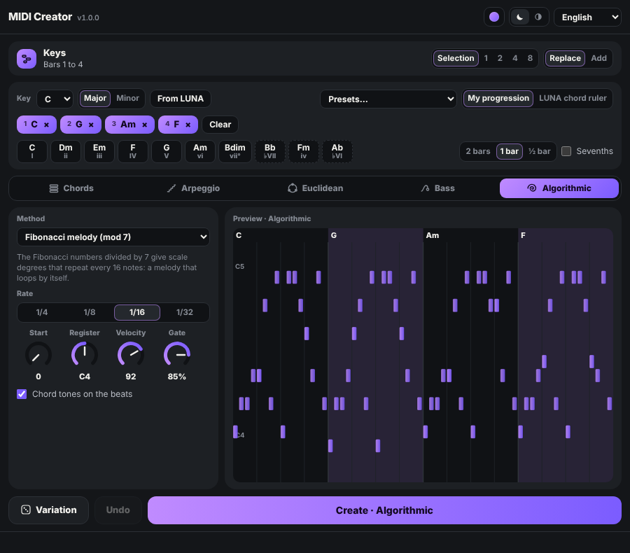
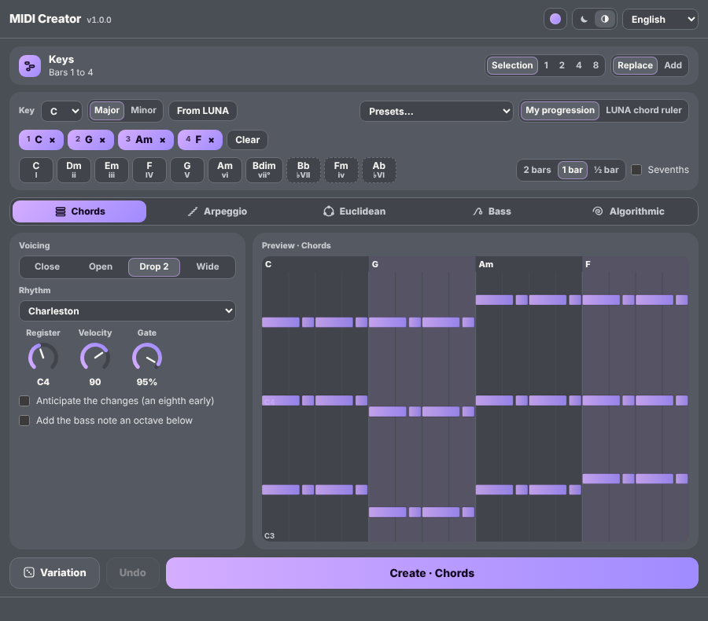

# MIDI Creator for LUNA

Build a chord progression in a key, or follow LUNA's chord ruler, and write chords, arpeggios,
Euclidean rhythms, a bass line or algorithmic parts (Fibonacci, cellular automata, L-systems,
chaos, phasing, tintinnabuli…) from it on a MIDI track. Every part follows the same
progression, so they fit together. Preview first, then Create: one undo step.

  
  

## Features

- **Progression:** pick the key (or read it from the session), then click the key's chords
  (and the usual borrowed ones) to build a progression, start from one of 13 common ones —
  pop I–V–vi–IV, 50s, canon, royal road, jazz ii–V–I, turnaround, 12-bar blues, minor pop,
  Andalusian, epic and more — or follow the chords on LUNA's chord ruler. Triads or sevenths,
  and two bars, one bar or half a bar per chord.
- **Chords:** close, open, drop 2 or wide voicings, with smooth voice leading from chord to
  chord. Eight rhythms (held, halves, quarters, eighths, Charleston, tresillo 3-3-2, offbeats and
  pop), changes anticipated by an eighth, and an optional bass note an octave below.
- **Arpeggio:** up, down, up-down, down-up, converge, pedal or random; 1/4 to 1/32, straight,
  triplet or dotted; 1 to 4 octaves, with gate and accent on the beats.
- **Euclidean:** three layers, each with its steps, hits and rotation, playing a drum note
  (General MIDI names), the chord's root, its chord tones, or a walk on the scale.
- **Bass:** root, pulse, octaves, root–fifth, arpeggio, pop or a walking line with approach
  notes into each chord.
- **Algorithmic:** eleven methods, all in the key and following the chords:
  - *Fibonacci:* durations of 1, 1, 2, 3, 5, 8 steps; a melody from the Fibonacci numbers
    modulo 7, which loops by itself every 16 notes; and the Fibonacci word rhythm, built on the
    golden ratio, which almost repeats and never quite does.
  - *Systems:* cellular automata (rules 30, 45, 73, 90, 110, 150), L-systems (Fibonacci, Cantor,
    Koch, dragon) and chaos with the logistic map, from order to period doubling to chaos.
  - *Composers:* Steve Reich's phasing (Clapping Music, bembé, son clave, tresillo), Arvo Pärt's
    tintinnabuli and a twelve-tone row with its mirror forms.
  - *Curiosities:* text to music (Morse code for the rhythm, letters for the notes) and the
    digits of π, e and φ, the primes or a Collatz sequence.
- **Where it writes:** the selected MIDI track, over the selection, the loop, or 1, 2, 4 or 8
  bars; replacing the notes that are there or adding to them. The clip grows when it needs to.
- **Preview and Variation:** see the notes over the bars and the chords before writing, and
  roll a new variation whenever you like.
- **Your colour:** yellow, orange, red, green, blue, pink or purple; dark and grey themes.
- **7 languages:** English, Español, Català, Français, Deutsch, Italiano and Português.

## How to use it

1. In LUNA, select an instrument track and, if you like, a range or a loop.
2. In **MIDI Creator**, set the key and the progression, pick a generator and adjust it while
   you watch the preview.
3. Press **Create**. Undo with Cmd+Z in LUNA or the **Undo** button.

## Support

If something does not work as expected, Alt-click the version number at the top of the window:
it copies a short report to paste in a message to fedetrillo@gmail.com.

## Install

Requires LUNA 3.1.2 or later. Install it from LUNA's Add On marketplace, or download
`midicreator.lunaaddon` from the latest release and double-click it. Then open a session and
choose **Add Ons > Windows > MIDI Creator**.

## En español

Monta una progresión de acordes en una tonalidad, o sigue la regla de acordes de LUNA, y escribe
acordes, arpegios, ritmos euclidianos o una línea de bajo en una pista MIDI. Todas las partes
siguen la misma progresión, así que encajan entre sí. Vista previa, variaciones, modo oscuro y
gris, siete colores y 7 idiomas.

## Licence

Copyright (c) 2026 Fede Trillo. All rights reserved. Free to install and use in LUNA; the code
may not be copied, modified or redistributed. See [LICENSE](LICENSE). The bundled LUNA Builder
SDK is Universal Audio's, under the Apache License 2.0: see
[THIRD_PARTY_NOTICES.md](THIRD_PARTY_NOTICES.md).

Contact: fedetrillo@gmail.com
